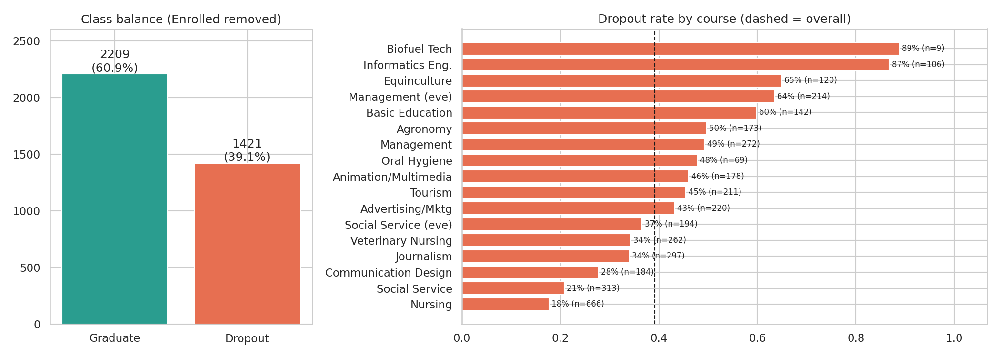
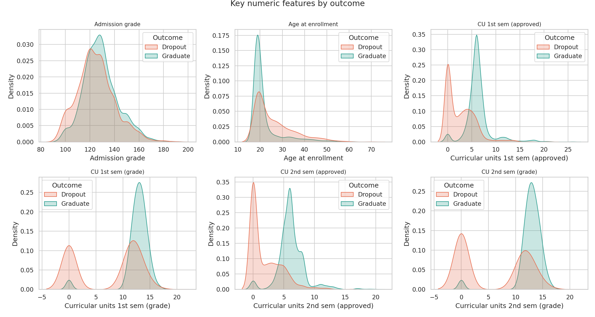
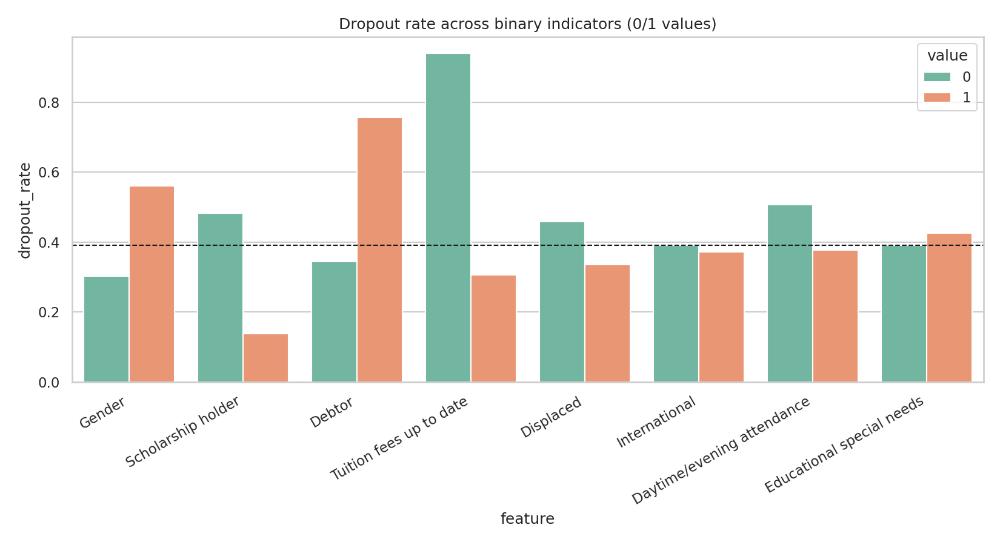
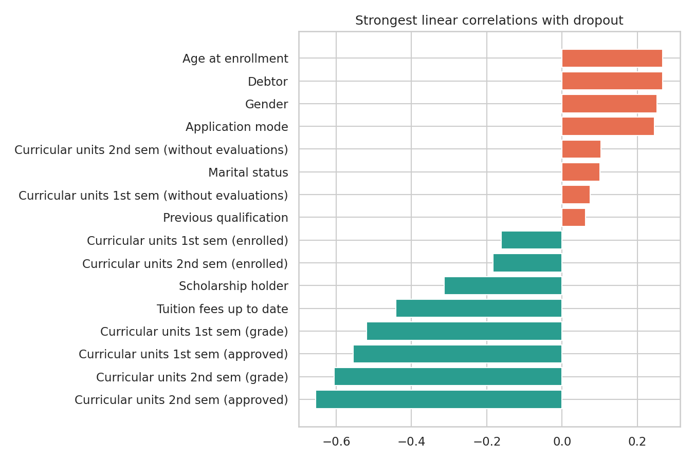
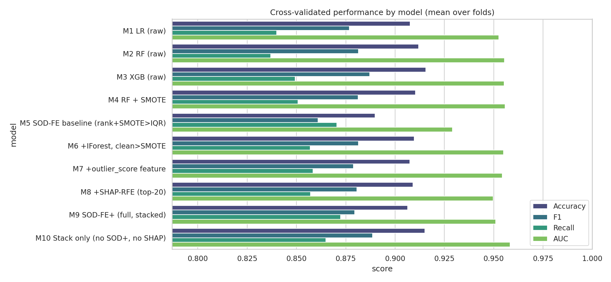
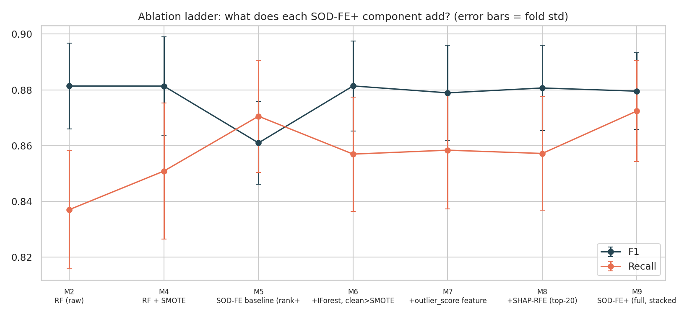
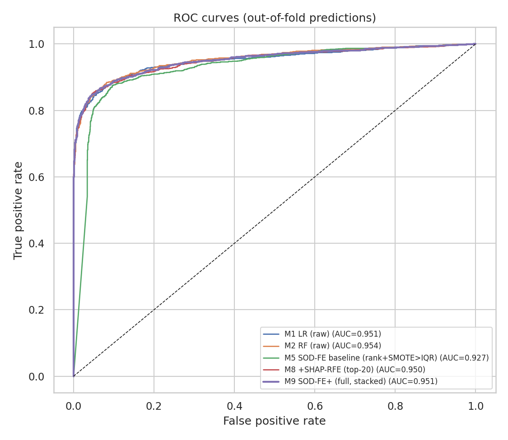
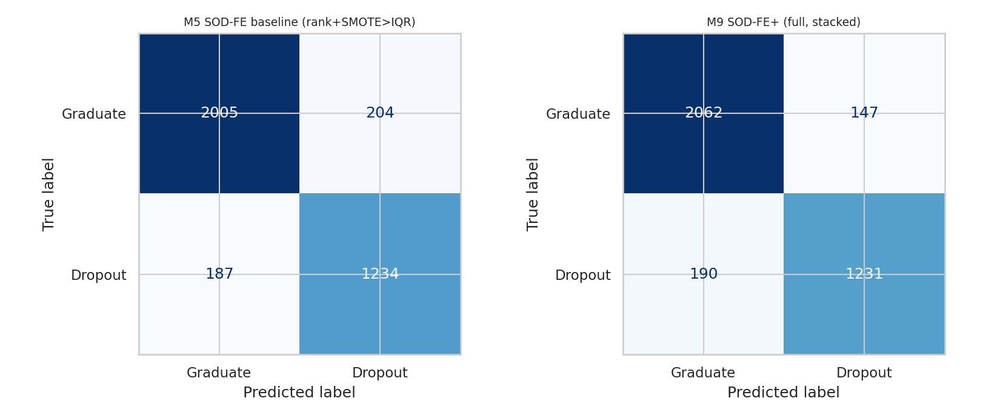
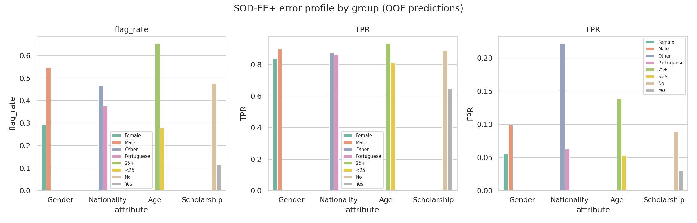
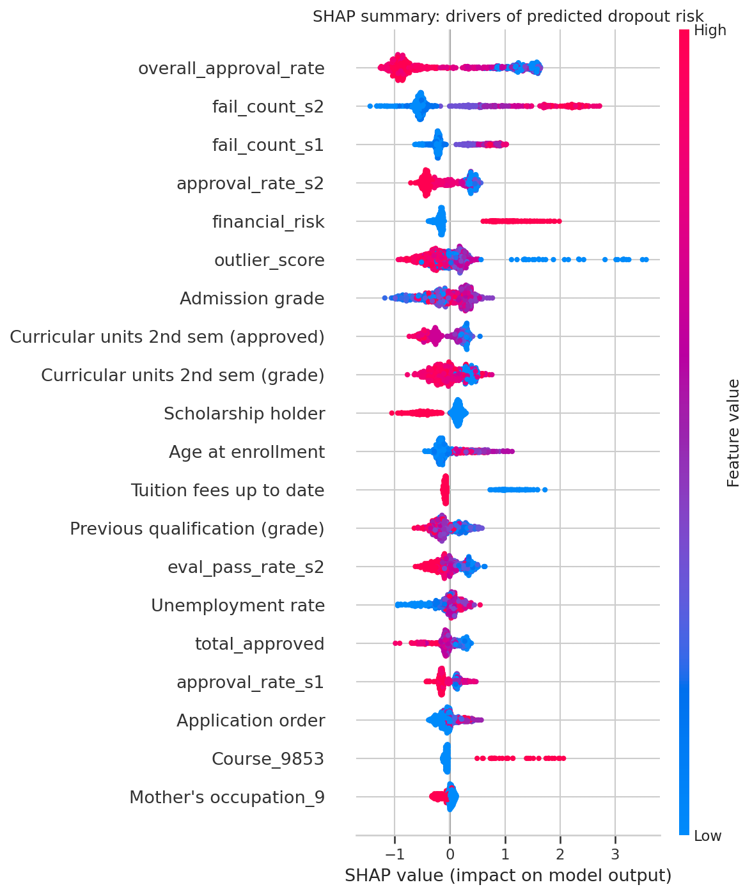

# SOD-FE+ — Student Dropout Prediction: Results

*Data: UCI 697 (Portugal), 3,630 students after removing 'Enrolled'. 5-fold stratified CV x 3 repeats; all preprocessing, outlier removal, SMOTE and feature selection fitted inside training folds only.*

## 1. Data cleaning

- Raw shape (4424, 37); missing cells: **0**; duplicate rows: **0**.
- Fixed file quirks: UTF-8 BOM, stray tab in `Daytime/evening attendance`, typo `Nacionality`, `;` separator.
- 'Enrolled' students (794) removed: outcome unknown. Target: Dropout=1.
- Consistency checks (counts): {"1st: approved > enrolled": 0, "1st: approved>0 but grade==0": 0, "1st: enrolled==0 (no activity)": 152, "2nd: approved > enrolled": 0, "2nd: approved>0 but grade==0": 0, "2nd: enrolled==0 (no activity)": 152, "age < 17": 0, "admission grade outside 0-200": 0}
- Outliers: IQR flags 1169 students on any continuous feature; Isolation Forest (5%) flags 182, of which 81 are invisible to IQR (multivariate-only).

## 2. Main EDA findings

## 3. Model comparison (CV mean ± std)

| Model | Accuracy | F1 | Recall | Precision | AUC | avg rows removed |
|---|---|---|---|---|---|---|
| M1 LR (raw) | 0.908 ± 0.012 | 0.877 ± 0.017 | 0.840 ± 0.025 | 0.917 ± 0.020 | 0.953 ± 0.008 | 0 |
| M2 RF (raw) | 0.912 ± 0.011 | 0.881 ± 0.015 | 0.837 ± 0.021 | 0.931 ± 0.018 | 0.955 ± 0.008 | 0 |
| M3 XGB (raw) | 0.916 ± 0.011 | 0.887 ± 0.016 | 0.849 ± 0.025 | 0.929 ± 0.017 | 0.955 ± 0.009 | 0 |
| M4 RF + SMOTE | 0.910 ± 0.013 | 0.881 ± 0.018 | 0.851 ± 0.024 | 0.915 ± 0.020 | 0.956 ± 0.008 | 0 |
| M5 SOD-FE baseline (rank+SMOTE>IQR) | 0.890 ± 0.012 | 0.861 ± 0.015 | 0.871 ± 0.020 | 0.852 ± 0.021 | 0.929 ± 0.011 | 112 |
| M6 +IForest, clean>SMOTE | 0.910 ± 0.012 | 0.881 ± 0.016 | 0.857 ± 0.021 | 0.908 ± 0.020 | 0.955 ± 0.007 | 57 |
| M7 +outlier_score feature | 0.907 ± 0.013 | 0.879 ± 0.017 | 0.858 ± 0.021 | 0.901 ± 0.020 | 0.954 ± 0.007 | 57 |
| M8 +SHAP-RFE (top-20) | 0.909 ± 0.011 | 0.881 ± 0.015 | 0.857 ± 0.020 | 0.906 ± 0.019 | 0.950 ± 0.009 | 57 |
| M9 SOD-FE+ (full, stacked) | 0.906 ± 0.011 | 0.880 ± 0.014 | 0.872 ± 0.018 | 0.887 ± 0.019 | 0.951 ± 0.009 | 57 |
| M10 Stack only (no SOD+, no SHAP) | 0.915 ± 0.013 | 0.889 ± 0.016 | 0.865 ± 0.023 | 0.914 ± 0.021 | 0.958 ± 0.007 | 0 |

## 4. Hypothesis test — SOD-FE+ (M9) vs SOD-FE baseline (M5)

| Metric | SOD-FE+ | Baseline | Diff | corrected-t p | Wilcoxon p | folds won |
|---|---|---|---|---|---|---|
| F1 | 0.8795 | 0.8609 | +0.0186 | 0.0233 | 0.0006 | 13/15 |
| Recall | 0.8724 | 0.8705 | +0.0019 | 0.7749 | 0.4203 | 7/15 |
| AUC | 0.9511 | 0.9291 | +0.0220 | 0.0002 | 0.0001 | 15/15 |
| Accuracy | 0.9064 | 0.8899 | +0.0165 | 0.0200 | 0.0015 | 13/15 |

**Verdict on H0 (no F1 difference):** rejected at α=0.05; F1 difference = +0.0186. Best mean F1 overall: **M10 Stack only (no SOD+, no SHAP)** (0.8885).

Hold-out (20%) result for SOD-FE+: Accuracy=0.897, F1=0.866, Recall=0.856, Precision=0.877, BalAcc=0.889, AUC=0.949

## 5. Fairness audit (SOD-FE+, out-of-fold)

| attribute   |   demographic_parity_gap |   equal_opportunity_gap |   fpr_gap |   disparate_impact_ratio |
|:------------|-------------------------:|------------------------:|----------:|-------------------------:|
| Age         |                    0.375 |                   0.124 |     0.086 |                    0.427 |
| Gender      |                    0.256 |                   0.064 |     0.043 |                    0.532 |
| Nationality |                    0.088 |                   0.009 |     0.16  |                    0.812 |
| Scholarship |                    0.36  |                   0.24  |     0.059 |                    0.243 |

## 6. Explainability

Top SHAP drivers: overall_approval_rate, fail_count_s2, fail_count_s1, approval_rate_s2, financial_risk, outlier_score, Admission grade, Curricular units 2nd sem (approved).

## 7. Caveats

- Features include 2nd-semester results, so this is an end-of-first-year early-warning model, not an enrolment-time one.
- SMOTE on one-hot columns creates fractional dummy values; stacking's inner CV sees SMOTE-generated neighbours. Both are standard but slightly optimistic for CV of the stack.
- Single institution, 2008–2019; no causal claims. Demographic-parity gaps partly reflect real base-rate differences — compare `flag_rate` with `base_rate` in `tables/fairness_by_group.csv`.